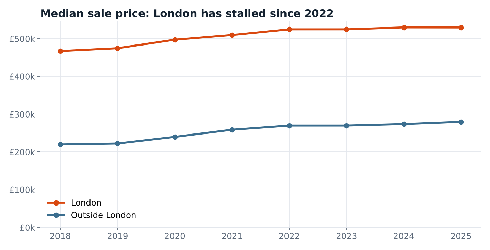
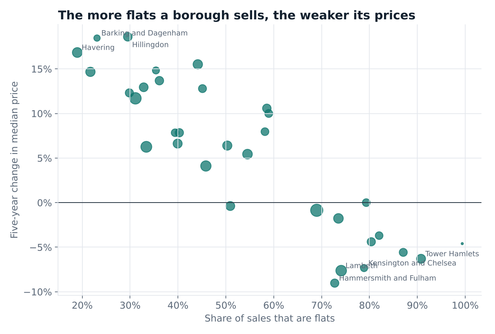
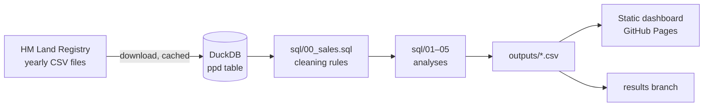

# UK Housing Market Analytics

[](https://github.com/EgeErenler/uk-housing-analytics/actions/workflows/ci.yml)
[](https://github.com/EgeErenler/uk-housing-analytics/actions/workflows/analyse.yml)

A SQL analysis of every residential property sale in England and Wales since 2018,
using HM Land Registry's Price Paid Data (about 1 million sales a year).

**Interactive dashboard: [egeerenler.com/uk-housing-analytics](https://egeerenler.com/uk-housing-analytics/)**
**Findings: [REPORT.md](REPORT.md)**

## Key findings

- **London has stalled.** From 2018 to 2025 the median price rose 27% outside London but only
  13% in London, and barely moved after 2022.
- **The expensive centre fell.** Four of London's five most expensive boroughs are cheaper
  than in 2020. Outer boroughs such as Hillingdon and Barking and Dagenham rose about 18%.
- **Flats explain most of it.** A borough's share of flat sales has a −0.88 correlation with
  its five-year price change.
- **Same home, real returns.** London flats gained a median 1.5% a year between sales, and
  23% were sold at a loss. Outside London, homes gained 4.6% a year.





## Questions

1. How have prices and activity changed since 2018, in London and outside it?
2. How did policy (the stamp duty holiday, the 2022 mini-budget) show up in sales?
3. How do London's 33 boroughs compare on price, growth and housing mix?
4. What return did owners actually make? (repeat-sales analysis)
5. How large is the premium for a new-build home?

## How it works



A monthly GitHub Actions workflow downloads the files, runs every SQL file in order,
exports the result tables as CSV and publishes the dashboard.

## The SQL

Each file in [`sql/`](sql) builds tables named `out_*`, which are exported automatically.

| File | What it does | Techniques |
|---|---|---|
| `00_sales.sql` | Cleaning rules and the base `sales` table | `CASE`, macros, filters with documented reasons |
| `01_market_overview.sql` | Yearly and monthly prices and volumes, price bands | `MEDIAN`, quantiles, `LAG` for year-on-year change, rolling windows |
| `02_property_types.sql` | Type mix, new-build premium, leasehold share | `FILTER` clauses, shares with window sums |
| `03_london_boroughs.sql` | Borough league table and history, top postcode districts | conditional pivots, `DENSE_RANK`, `QUALIFY` |
| `04_repeat_sales.sql` | Same-home price changes and annualised returns | self-matching with `LAG` over a property key, `GROUPING SETS` |
| `05_data_quality.sql` | What the cleaning removed, data coverage | audit counts |

## Cleaning rules

- Only **category A** sales (standard market sales). Category B covers repossessions,
  buy-to-let companies and other non-standard sales.
- Rows marked as **deleted** in update files are removed.
- Property type **O (Other)**, which is mostly commercial or mixed use, is excluded.
- Year-on-year comparisons only use **complete years**.
- Repeat sales need at least **one year** between sales, the **same property type**
  both times, and a price ratio between 0.3 and 5 to drop likely data errors.

## Tests

The SQL is tested with pytest on small, hand-made datasets where the answer is known.
For example, a home sold for £400k and again for £484k exactly two years later must show
a 10% annual return. A full pipeline test runs on synthetic files in the real format.

## Run it yourself

```bash
git clone https://github.com/EgeErenler/uk-housing-analytics.git
cd uk-housing-analytics
pip install -e ".[dev]"

make demo   # synthetic data, runs in seconds
make data   # real data: about 1.5 GB of downloads
```

## Data and licence

Contains HM Land Registry data © Crown copyright and database right. This data is licensed
under the Open Government Licence v3.0. Code released under the MIT licence.

## Author

**Ege Erenler**, software engineer and data scientist in London.
[egeerenler.com](https://egeerenler.com) · [LinkedIn](https://www.linkedin.com/in/ege-erenler)
