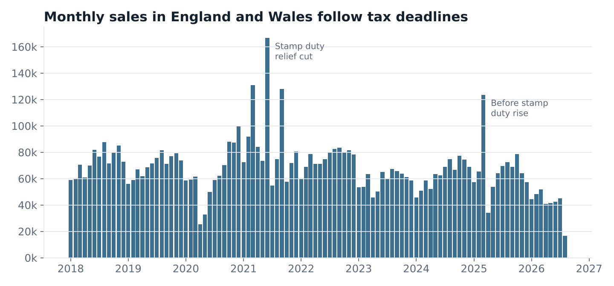
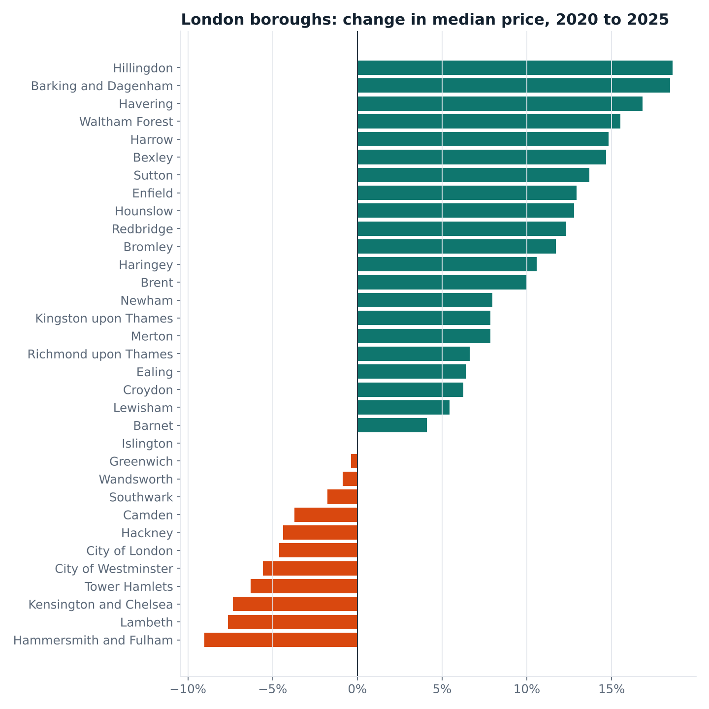

# Findings: England and Wales housing market, 2018 to 2026

*Data: HM Land Registry Price Paid Data, sales from 1 January 2018 to 28 August 2026.
7,081,652 standard residential sales after cleaning. Full year figures use 2018 to 2025.*

## Summary

1. **London has stalled; the rest of the country has not.** Between 2018 and 2025 the median
   price rose 27% outside London but only 13% in London. A London home cost 2.13 times one
   elsewhere in 2018, and 1.89 times in 2025.
2. **Inside London, the expensive centre fell and the cheaper outer boroughs rose.** Four of
   the five most expensive boroughs are cheaper than five years ago. The biggest gains were in
   Hillingdon (+18.6%), Barking and Dagenham (+18.5%) and Havering (+16.8%).
3. **Flats explain most of the split.** Across boroughs, the share of sales that are flats
   has a correlation of −0.88 with five-year price change.
4. **Owners of London flats did worst.** Comparing the same home with itself, London flats
   gained a median 1.5% a year, and 23% sold for less than their previous price. Outside
   London, homes gained 4.6% a year and 7% sold at a loss.
5. **Tax deadlines drive activity.** The busiest month in the data is June 2021 (166,695
   sales), the last month of the full stamp duty holiday. March 2025, before thresholds fell,
   had 123,605 sales; April 2025 had 33,952.

## 1. Prices: London stalls, the rest keeps climbing

| Median price | 2018 | 2022 | 2025 | 2018 to 2025 |
|---|---:|---:|---:|---:|
| England and Wales | £235,000 | £290,000 | £298,000 | +26.8% |
| London | £467,500 | £525,000 | £530,000 | +13.4% |
| Outside London | £219,950 | £270,000 | £280,000 | +27.3% |

London's median moved by just 1% between 2022 and 2025. Outside London, prices were flat
in 2023 after the rise in mortgage rates, then kept growing.

## 2. Activity follows policy

- **2020:** sales collapsed in April and May during the first lockdown.
- **2021:** the stamp duty holiday made it the busiest year in the data, with 1,086,934
  sales (+44% on 2020). Sales peaked in June and September 2021, when the relief stepped
  down and then ended.
- **2023:** after the September 2022 mini-budget pushed mortgage rates up, sales fell to
  708,315, the lowest full year in the data (−35% on 2021).
- **2025:** sales recovered to 809,461, still 26% below the 2021 peak. The spike in March
  2025 came just before stamp duty thresholds fell on 1 April 2025.

The data records the date a sale *completed*, so policy effects show up a few months after
the announcement. The most recent months are also undercounted, because some sales take
weeks or months to be registered.

## 3. London's boroughs: the doughnut effect

| Most expensive (2025) | Median | 5-year change |
|---|---:|---:|
| Kensington and Chelsea | £1,200,000 | −7.3% |
| City of Westminster | £897,000 | −5.6% |
| City of London | £820,000 | −4.6% |
| Camden | £780,000 | −3.7% |
| Richmond upon Thames | £725,000 | +6.6% |

| Fastest growth, 2020 to 2025 | Median | 5-year change |
|---|---:|---:|
| Hillingdon | £510,000 | +18.6% |
| Barking and Dagenham | £385,000 | +18.5% |
| Havering | £451,000 | +16.8% |

Eleven of the 33 boroughs are cheaper than five years ago. The largest fall was in
Hammersmith and Fulham (−9.0%). The correlation between a borough's price level and its
five-year change is −0.61: the dearer the borough, the weaker its recent growth.

The City of London had only 161 sales in 2025, so its figures are less reliable.

## 4. Why: flats

The pattern lines up closely with housing type. Boroughs where most sales are flats, such as
Tower Hamlets (91%), Kensington and Chelsea (79%) and Hammersmith and Fulham (73%), fell.
Boroughs dominated by houses, such as Havering (19% flats), rose the most. The correlation
is −0.88.

This is a correlation, not proof of cause. Likely drivers include demand for more space after
2020, the cladding and building safety issues that hit flat sales, and the rise of remote work.

## 5. What owners actually made: repeat sales

Median prices change when a different mix of homes sells. To avoid that, the analysis finds
841,641 pairs of sales of the *same home* (at least a year apart, same property type) and
measures the yearly return between them.

| | Pairs | Median yearly return | Sold at a loss |
|---|---:|---:|---:|
| London, all homes | 66,044 | 2.5% | 16.0% |
| London, flats | 40,621 | 1.5% | 23.1% |
| London, terraced houses | 17,027 | 3.9% | 4.2% |
| Outside London, all homes | 775,597 | 4.6% | 7.3% |
| Outside London, flats | 124,229 | 2.5% | 18.5% |

Tower Hamlets stands out: a median return of 0.4% a year, and 40% of repeat sales were at a
loss. Waltham Forest had the best median return in London, at 3.5% a year.

## 6. The new-build premium

In 2025, a new-build flat sold for 33% more than an existing flat in London, and 65% more
outside London. For houses the premium was much smaller, and for detached homes outside
London new builds were slightly *cheaper* (−2%).

The data has no floor area, so part of the flat premium reflects size and quality, not just
newness. New detached houses are often smaller than older ones, which fits the negative
figure.

## 7. Affordability at the bottom of the market

The share of sales under £250,000 in England and Wales fell from 54% in 2018 to 37% in 2025.
Outside London it fell from 59% to 41%. In London, only 5% of sales were under £250,000 in
2025, and 14% were over £1 million.

## Method and limits

- Only category A (standard market) sales of detached, semi-detached, terraced and flat
  homes. Category B and "Other" property types are excluded.
- London means Greater London. Five-year changes compare 2020 with 2025, using medians.
- Medians are not adjusted for size or quality. The repeat-sales view helps with that, but
  homes that sell twice may differ from homes that do not.
- Recent months are undercounted because of registration delays.
- Every figure in this report comes from the CSV outputs of the SQL in `sql/`.
